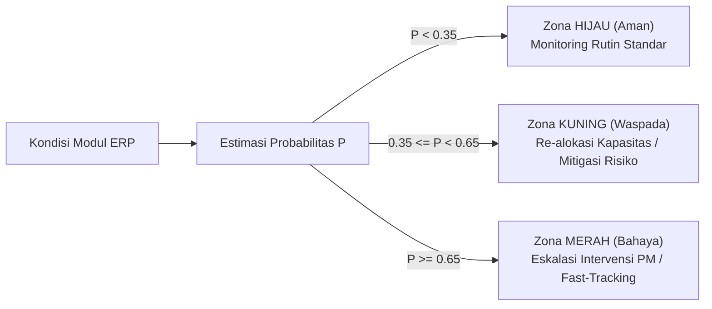

# PRE-02: Sistem Prediksi Probabilitas Keterlambatan Proyek Berbasis Machine Learning sebagai Early Warning System Manajemen Proyek

[](https://www.python.org/)
[](LICENSE)
[]()
[]()
[]()

> **Repositori Resmi Riset & Tugas Besar Berjenjang Mata Kuliah Teori Manajemen Proyek (2026)**  
> **Program Studi:** S1 Teknik Informatika, Fakultas Sains dan Teknologi  
> **Institusi:** Universitas Islam Negeri Maulana Malik Ibrahim Malang  
> **Dosen Pengampu:** Dr. Muhammad Ainul Yaqin, S.Si, M.Kom  
> **Penanggung Jawab Riset / Lead Author:** Muhammad Nailul Ghufron Majid (NIM: 240605110160)

---

## 📌 Ringkasan Eksekutif & Abstrak Riset

Manajemen proyek pengembangan perangkat lunak berskala *enterprise* (seperti sistem ERP) kerap menghadapi risiko pembengkakan jadwal akibat keterbatasan alokasi tim pengembang bersama (*shared developers*) dan tingginya ketergantungan antar-modul (*inter-module dependencies*). Pendekatan evaluasi konvensional umumnya mengandalkan klasifikasi biner diskrit (*Terlambat vs Tepat Waktu*) yang tidak memberikan gradasi risiko kepastian kuantitatif.

Penelitian **PRE-02** memformulasikan sistem peramalan risiko berbasis **probabilitas numerik kontinu $[0.0 - 1.0]$ yang terkalibrasi secara statistik** sebagai *Early Warning System* (EWS) bagi Manajer Proyek. Melalui studi kasus portofolio modul **Super ERP Farm Nation Enterprise (FNE) 2026** ($N = 26$ aktivitas operasional), penelitian ini membandingkan empat algoritma *supervised machine learning* (*Logistic Regression, Random Forest, Gradient Tree Boosting,* dan *Multi-Layer Perceptron / MLP*) dengan teknik kalibrasi pasca-pelatihan (*Platt Scaling* dan *Isotonic Regression*).

### 🔍 Kebaruan Ilmiah (4 Lapis Research Gap yang Dijembatani)
1. **Joint Resource–Dependency Gap:** Memodelkan keterbatasan kapasitas pengembang bersama (*resource constraints*) dan ketergantungan antar-tugas (*predecessor dependencies*) secara simultan.
2. **Module-Level Granular Probability Gap:** Mengestimasi probabilitas risiko secara spesifik pada level modul fungsional ERP, bukan sekadar agregasi makro portofolio.
3. **Delay Propagation Gap:** Mengukur efek transmisi keterlambatan berantai (*cascading delay*) antar-modul melalui variabel terukur *Predecessor Count*.
4. **Calibration Gap:** Mengevaluasi keluaran probabilitas menggunakan metrik kuadratik *Brier Score*, *Log Loss*, dan *Expected Calibration Error* (ECE) untuk menjamin probabilitas dapat dipercaya sebagai ambang peringatan operasional.

---

## 📊 Dataset & Operasionalisasi Variabel

Dataset resmi tersimpan pada berkas [`dataset_pre02_fne_v3.csv`](dataset_pre02_fne_v3.csv) yang diekstraksi dari 8 dokumen *Project Management Plan* (PMP) dan *Software Requirements Specification* (SRS) Super ERP FNE 2026:

| Simbol | Nama Fitur | Definisi Operasional | Skala / Satuan |
| :---: | :--- | :--- | :---: |
| $X_1$ | `Planned_Duration_Days` | Estimasi durasi pengerjaan modul sesuai baseline jadwal | Hari Kalender |
| $X_2$ | `Planned_Effort_Hours` | Beban jam kerja personil yang dialokasikan | Person-Hours |
| $X_3$ | `Predecessor_Count` | Jumlah aktivitas prasyarat langsung (ketergantungan struktural) | Integer ($\ge 0$) |
| $X_4$ | `Resource_Utilization_Rate` | Rasio beban alokasi pengembang terhadap batas kapasitas normal | Rasio Kontinu ($\ge 0$) |
| $X_5$ | `Risk_Score` | Indeks probabilitas-dampak ($P \times I$) pada register risiko modul | Kontinu $[0.0 - 1.0]$ |
| $X_6$ | `SPI_Value` | Schedule Performance Index ($EV / PV$) pada titik pantau | Rasio Kontinu |
| $X_7$ | `Change_Request_Count` | Frekuensi usulan perubahan ruang lingkup yang diajukan | Integer ($\ge 0$) |
| **$Y$** | **`Delay_Status`** | **Status Keterlambatan Aktual Modul (Target Klasifikasi)** | **Biner $\{0, 1\}$** |

---

## 🧪 Hasil Evaluasi Eksperimen & Kalibrasi Model

Eksperimen dievaluasi menggunakan protokol **Stratified 5-Fold Cross-Validation** (seed = 42) dengan standardisasi fitur *z-score* per fold. Seluruh nilai probabilitas diuji sebelum (*Raw*) dan sesudah kalibrasi (*Platt Scaling* & *Isotonic Regression*):

### Tabel Kinerja 5-Fold Cross-Validation

| Model Algoritma | Kalibrasi | ROC-AUC | Brier Score ↓ | Log Loss ↓ | ECE ↓ | Akurasi | Recall | F1-Score |
| :--- | :---: | :---: | :---: | :---: | :---: | :---: | :---: | :---: |
| **MLP Neural Network** ⭐ | **Raw** | **1.0000** | **0.0007** | **0.0079** | **0.0075** | **100.0%** | **1.000** | **1.0000** |
| MLP Neural Network | Platt | 1.0000 | 0.0164 | 0.1049 | 0.0947 | 100.0% | 1.000 | 1.0000 |
| MLP Neural Network | Isotonic | 1.0000 | 0.0016 | 0.0114 | 0.0106 | 100.0% | 1.000 | 1.0000 |
| Logistic Regression (Baseline) | Raw | 1.0000 | 0.0254 | 0.1133 | 0.0943 | 96.2% | 1.000 | 0.9697 |
| Logistic Regression (Baseline) | Platt | 0.9938 | 0.0290 | 0.1336 | 0.0798 | 96.2% | 1.000 | 0.9697 |
| Random Forest | Raw | 0.9938 | 0.0391 | 0.1367 | 0.0640 | 92.3% | 0.938 | 0.9375 |
| Random Forest | Platt | 0.9938 | 0.0459 | 0.1780 | 0.1040 | 92.3% | 0.938 | 0.9375 |
| Gradient Boosting | Platt | 0.8813 | 0.0889 | 0.3278 | 0.0709 | 88.5% | 0.875 | 0.9032 |

*Keterangan: ⭐ = Model Rekomendasi Utama (Brier Score terendah = 0.0007, ECE terendah = 0.0075).*

### Temuan Analisis Fitur (Feature Importance)
Berdasarkan analisis Mean Decrease Impurity (MDI) pada Random Forest, dua faktor yang paling dominan memicu keterlambatan modul adalah:
1. **`SPI_Value` ($33.5\%$)**: Indikator deviasi progres historis berbasis Earned Value.
2. **`Risk_Score` ($27.4\%$)**: Beban risiko inheren yang belum termitigasi.
3. Disusul oleh `Resource_Utilization_Rate` ($16.2\%$) dan `Predecessor_Count` ($10.8\%$).

---

## 🚨 Arsitektur Ambang Batas Peringatan Dini (Early Warning System)

Sistem mengklasifikasikan probabilitas keterlambatan $P$ ke dalam 3 zona peringatan operasional:



* **Zona Hijau ($P < 0.35$):** Risiko minimal, eksekusi berjalan sesuai baseline jadwal.
* **Zona Kuning ($0.35 \le P < 0.65$):** Indikasi awal deviasi; tim disiagakan untuk penyesuaian beban kerja.
* **Zona Merah ($P \ge 0.65$):** Alarm bahaya aktif; memicu tindakan intervensi manajerial (*crashing* jadwal, perataan sumber daya, atau revisi scope). Ambang batas diskriminasi optimal Youden $J$ berada pada $\theta^* = 0.4830$ (Sensitivitas = 1.00, Spesifisitas = 1.00).

---

## 📁 Struktur Direktori Repositori

```
MP-PRE-02-Kelompok-github/
├── README.md                                  # Dokumentasi utama repositori (dokumen ini)
├── requirements.txt                           # Dependensi pustaka Python
├── LICENSE                                    # Lisensi sumber terbuka (MIT License)
├── .gitignore                                 # Aturan pengabaian berkas sementara Git
├── dataset_pre02_fne_v3.csv                   # Dataset resmi (N = 26 modul operasional)
│
├── 01_pemahaman_umum/                         # PROGRES 1: Orientasi Riset & Konsep
│   └── PRE02_Pertemuan1_Pemahaman_Umum.pptx
│
├── 02_Studi Literatur/                        # PROGRES 2: Tinjauan Pustaka & Research Gap
│   ├── Research gap.md                        # Formulasi 4 lapis research gap bertingkat
│   ├── Sintesis Naratif.md                    # Narasi sintesis 28 literatur internasional
│   ├── Tinjauan Pustaka.md                    # Matriks perbandingan 28 paper ilmiah
│   └── arsip_matriks/                         # Draf kerja awal literatur
│
├── 03_persiapan_data/                         # PROGRES 3: Karakteristik Data & Preprocessing
│   ├── Pertemuan3_Persiapan_dan_Karakteristik_Data.md
│   ├── dataset_pre02_fne_v3.csv               # Salinan dataset aktif
│   └── arsip_dataset/                         # Versi arsip (v1, v2)
│
├── 04_implemen_desain_eksperimen/             # PROGRES 4: Metodologi & Pipeline Eksekusi
│   ├── 01_Flow_dan_Skenario_Eksperimen.md     # Spesifikasi alur eksperimen
│   ├── 02_Draft_Metodologi_Eksperimen_Bab3.md # Draf Bab III Metodologi Penelitian
│   ├── experiment_pipeline.py                 # Script utama eksekusi ML & kalibrasi
│   ├── generate_pertemuan4_pptx.py            # Generator slide pertemuan 4
│   ├── PRE02_Pertemuan4_Implementasi_Desain_Eksperimen.pptx
│   └── hasil_eksperimen/                      # Output visual & tabel metrik numerik
│       ├── 00_RINGKASAN_TEMUAN_EKSPERIMEN.md  # Temuan kuantitatif otomatis
│       ├── kurva_roc_perbandingan.png         # Grafik perbandingan ROC
│       ├── kurva_kalibrasi_probabilitas.png   # Kurva kalibrasi probabilitas
│       ├── feature_importance_comparison.png  # Grafik kepentingan fitur
│       ├── log_pelaksanaan_eksperimen.md      # Catatan log eksekusi fold
│       ├── tabel_metrik_evaluasi.csv          # Hasil numerik lengkap 5-fold CV
│       └── tabel_prediksi_probabilitas_task.csv
│
├── 05_presentasi_progres/                     # PROGRES 5: Presentasi Terpadu P1–P5
│   ├── generate_presentasi_p1_p5.py           # Script generator slide presentasi
│   ├── PRE02_Presentasi_Progres_Pertemuan1-5.pptx # Deck slide presentasi resmi
│   ├── Naskah_Presentasi_P1-P5.md             # Naskah pemaparan lisan
│   └── Guideline_Presentasi_Pertemuan1-5.md
│
├── catatan_dosen/                             # Panduan Dosen Pengampu
│   ├── Penjelasan_Variabel_Dataset.md
│   ├── sumber_data_variabel.md
│   └── analisis_variabel.md
│
├── catatan_internal/                          # Catatan Kerja Internal Penulis
│   ├── My timeline as head.md
│   ├── p chek.md
│   └── MP-pep.md
│
├── judul_dan_progres_penelitian/              # Spesifikasi & Roadmap 8 Pertemuan Riset
│   ├── Deskripsi_Penelitian.md
│   └── progres_penelitian_MP.md
│
└── MP-datasetRaw/                             # Dokumen Sumber Mentah (8 PMP & 8 SRS ERP)
```

---

## 🚀 Panduan Menjalankan Replikasi Kode (Quickstart)

### 1. Kloning Repositori & Persiapan Lingkungan
```bash
git clone https://github.com/[username]/MP-PRE-02-Kelompok.git
cd MP-PRE-02-Kelompok
python -m venv .venv

# Di Windows:
.venv\Scripts\activate
# Di Linux/macOS:
source .venv/bin/activate

pip install -r requirements.txt
```

### 2. Menjalankan Pipeline Eksperimen & Kalibrasi ML
```bash
python 04_implemen_desain_eksperimen/experiment_pipeline.py
```
Output eksperimen berupa metrik evaluasi (`.csv`), grafik evaluasi (`.png`), dan ringkasan temuan (`.md`) akan secara otomatis diperbarui di folder `04_implemen_desain_eksperimen/hasil_eksperimen/`.

### 3. Menjalankan Generator Slide Presentasi
```bash
python 05_presentasi_progres/generate_presentasi_p1_p5.py
```

---

## 👥 Tim Peneliti & Kontributor
* **Muhammad Nailul Ghufron Majid** (NIM: 240605110160) — *Lead Author, Arsitektur Riset, & Metodologi Ilmiah*
* **Rekan Peneliti Kelompok PRE-02** — *Data Preprocessing, Eksperimen Machine Learning, & Dokumentasi*
* **Dr. Muhammad Ainul Yaqin, S.Si, M.Kom** — *Dosen Pembimbing & Pengampu Mata Kuliah Teori Manajemen Proyek*

---

## 📄 Lisensi
Seluruh kode program dan artefak riset didistribusikan di bawah lisensi terbuka [MIT License](LICENSE).
Dokumen spesifikasi proyek didasarkan pada studi kasus akademik *Super ERP Farm Nation Enterprise 2026*.
